# From First-Mile to Last-Mile: Economic Viability and Spatial Dynamics of Micro-Mobility in a Mature Urban Market – The Turin Case Study

*Davide Olivetti (348090) — Prof. Cristina Pronello — Politecnico di Torino, A.Y. 2025/2026*  
*Revised edition: corrected data processing and extended statistical analysis*  

> Generated by `report/build_report.py` from `report_source.md` and the pipeline outputs - edit the source, not this file.

## Abstract

This report analyses one full year (2024) of trip-level data from the three shared e-scooter operators active in Turin: Lime (Operator A), Voi (Operator B) and Bird (Operator C). After harmonisation and a sequential cleaning procedure, 1,593,163 valid trips remain: 1,124,211 for Lime, 98,295 for Voi and 370,657 for Bird. The revised analysis corrects several processing errors of the first edition and adds formal statistical inference throughout. Three corrections matter most. The Voi dataset previously mixed 2024 with ten months of 2025 and contained duplicated rows. Voi timestamps are in UTC. Self-containment had been computed after intra-zonal trips were deleted.

All three operators share the same working-day profile, with an AM peak at 08:00 and a PM peak at 18:00. Demand is significantly higher on Fridays and Saturdays (Friedman test on 52 weekly blocks, p < 10⁻⁵). About 11% of trips start and end in the same statistical zone, so the service is mainly, but not exclusively, inter-zonal. Trip generation is strongly spatially clustered (Moran's I = 0.56–0.68), and the morning/evening "tidal" pattern is statistically significant in 58–80% of the tested zones and consistent across operators (Spearman ρ = 0.61–0.66). A negative-binomial zonal model explains trip density through population density, distance from the centre and public-transport supply. Socio-economic hardship (ISTAT IDISE) has no detectable effect (IRR = 1.06, 95% CI 0.85–1.33). Sixty percent of trips connect two places already linked by a direct urban transit line, and one third start or end within 300 m of a metro station. The financial model, now with explicit uncertainty, confirms that only Lime is robustly profitable (P(profit > 0) = 100% across 20,000 Monte Carlo draws). Voi is loss-making in every scenario. Bird operates close to break-even, so its result depends on the fleet that is actually deployed.

## Introduction

Shared electric scooters have become a visible component of urban mobility, offering on-demand, short-distance trips that can either complement or compete with public transport. In Turin (≈ 845,000 residents), the Municipality collects anonymised trip-level data from the licensed operators. This study uses the 2024 data, the only complete calendar year available for all operators. Partial 2025 data exist (Lime until April, Voi until October, Bird until November) but were excluded to avoid mixing incomplete seasonal cycles. Dott, the fourth licensed operator, could not be included because its data were not yet available.

The datasets contain, for each trip, the vehicle identifier, start and end timestamps, origin and destination coordinates, distance and duration as reported by the operator, and a reservation flag. Lime and Voi also report the battery level at the start and end of the trip; Lime additionally provides the trajectory polyline (not used here, to keep the three operators comparable).

The analysis proceeds in six steps: (i) harmonisation and cleaning; (ii) descriptive analysis of demand, trips and fleet utilisation, with formal comparisons between operators; (iii) origin-destination (OD) analysis on the 94 official statistical zones, with significance tests and spatial statistics; (iv) idle time between trips and operator relocations; (v) comparison with the scheduled public-transport supply of GTT and a zonal demand model including socio-economic hardship; (vi) a financial model with uncertainty propagation.

Compared with the first edition, this version (a) fixes the data-processing errors listed in Appendix A, (b) replaces descriptive statements with tested ones (confidence intervals, effect sizes, multiple-testing control), and (c) makes every result reproducible from the raw files through a single open-source pipeline (`scripts/run_all.py`).

## 1. Data acquisition and cleaning

### 1.1 Harmonisation

Each operator delivers data in a different format: monthly CSV files (Lime), monthly Excel files with timestamps encoded as `YYYYMMDDhhmmss` integers (Voi), and a single annual CSV with minute-resolution timestamps (Bird). All files are converted to a common schema. Three operator-specific issues were found and handled.

* **Voi duplicates and year mixing.** The merged Voi file used in the first edition contained 276,902 rows, but these included January–October 2025 and 59,226 exact duplicates. Restricting to the twelve 2024 files and de-duplicating on the rental identifier gives 106,115 unique 2024 rentals.
* **Voi time zone.** Cross-correlating the hourly demand profile of Voi with that of Lime, month by month, gives a lag of exactly +1 h in winter months and +2 h in months under daylight-saving time. This is the signature of UTC timestamps; they were converted to local time (Europe/Rome). After conversion the lag is 0 in every month (`scripts/check_time_offsets.py`).
* **Voi January.** All January 2024 records are stamped `2024-01-00 00:00:00`. Their duration and distance are valid, so they are kept for volumes and the financial model, but excluded from every time-of-day or day-of-week analysis.

Trip distance is the geodesic (straight-line) distance between origin and destination, computed identically for all operators. It is a lower bound of the travelled distance.

### 1.2 Validation rules

A trip is considered valid if it lasts between 45 s and 3 h, its straight-line distance lies between 120 m and 15 km, its average speed does not exceed 35 km/h, both ends lie within the metropolitan bounding box, and it is not a duplicate (same vehicle and start time). Very short trips mostly correspond to unlocks without a ride, GPS jitter or service operations; very long or fast trips are not plausible for shared e-scooters in an urban context.

The filters are applied sequentially, so every removed record is counted once and the rows add up (the first edition counted each filter against the raw data, which double-counts records failing several rules).

**Table 1 – Sequential cleaning log (records removed at each step, % of raw records)**

| Step | A - Lime | B - Voi | C - Bird |
|:---|---:|---:|---:|
| Raw records | 1,196,210 | 106,115 | 390,844 |
| Outside reference year | 0 (0.00%) | 0 (0.00%) | 0 (0.00%) |
| Duplicated record (same vehicle and start time) | 0 (0.00%) | 0 (0.00%) | 12 (0.00%) |
| Coordinates missing or outside metropolitan area | 1 (0.00%) | 10 (0.01%) | 10 (0.00%) |
| Duration < 45 s | 21,310 (1.78%) | 3,059 (2.88%) | 950 (0.24%) |
| Duration > 3 h | 0 (0.00%) | 3 (0.00%) | 25 (0.01%) |
| Straight-line distance < 120 m | 50,452 (4.22%) | 4,742 (4.47%) | 18,878 (4.83%) |
| Straight-line distance > 15 km | 13 (0.00%) | 0 (0.00%) | 0 (0.00%) |
| Speed > 35 km/h | 223 (0.02%) | 6 (0.01%) | 312 (0.08%) |
| Valid trips | 1,124,211 (93.98%) | 98,295 (92.63%) | 370,657 (94.84%) |

The dominant reason for removal is a straight-line distance below 120 m (4.2–4.8% of records), followed by durations under 45 s. In total 6.0% of Lime, 7.4% of Voi and 5.2% of Bird records were removed.

## 2. Demand, trips and fleet utilisation

### 2.1 Overview

**Table 2 – Key indicators by operator, 2024**

| Indicator | A - Lime | B - Voi | C - Bird |
|:---|---:|---:|---:|
| Valid trips | 1,124,211 | 98,295 | 370,657 |
| Vehicles (unique IDs) | 2,189 | 1,180 | 2,082 |
| Mean vehicles active per day | 860 | 158 | 471 |
| Trips per active vehicle-day [95% CI] | 3.45 [3.38, 3.52] | 1.73 [1.71, 1.74] | 2.10 [2.07, 2.13] |
| Median duration, min [95% CI] | 8.03 [8.02, 8.05] | 7.85 [7.80, 7.88] | 10.35 [10.32, 10.38] |
| Median straight-line distance, km [95% CI] | 1.34 [1.34, 1.35] | 1.36 [1.35, 1.36] | 1.54 [1.54, 1.55] |
| Median speed, km/h [95% CI] | 10.66 [10.66, 10.67] | 10.96 [10.94, 10.98] | 10.21 [10.20, 10.23] |
| Reserved trips, % [95% CI] | 21.6 [21.6, 21.7] | 23.0 [22.7, 23.3] | 1.7 [1.7, 1.7] |
| Gini of trips per vehicle | 0.48 | 0.38 | 0.50 |
| Mean trips per day | 3,072 | 279 | 1,013 |

Lime carries 71% of all trips, Bird 23% and Voi 6%. The more relevant operating difference is utilisation. A Lime vehicle that is active on a given day performs on average 3.45 trips, against 2.10 for Bird and 1.73 for Voi. Trip characteristics are similar: median duration 8–10 minutes, median straight-line distance 1.3–1.5 km, median speed 10–11 km/h. With n ≈ 1.6 million, every difference is "significant" (Kruskal–Wallis p < 10⁻¹⁵⁰), so effect sizes are more informative. The operator explains only 2% of the variance in ranks of trip duration (ε² = 0.020) and less than 1% for distance and speed. The only non-negligible pairwise effect is that Bird trips are longer in time (Cliff's δ = −0.19 vs Lime and −0.21 vs Voi, a small effect). Practically, the three services are used for the same type of trip.

Reservations are used for 21.6% of Lime trips and 23.0% of Voi trips (95% CI 22.7–23.3%), but only for 1.7% of Bird trips. (The first edition reported 39.4% for Voi because it was computed on the merged 2024–2025 file.)

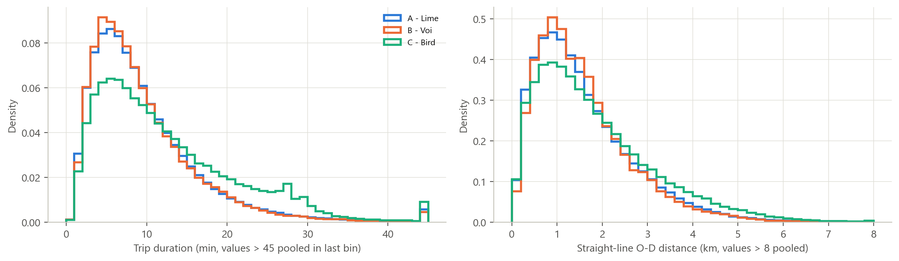

*Figure 1 – Distribution of trip duration and straight-line distance by operator.*

### 2.2 Seasonal pattern

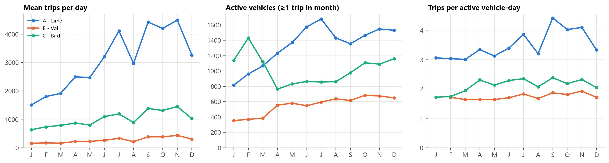

*Figure 2 – Monthly demand (mean trips per day), active vehicles and trips per active vehicle-day.*

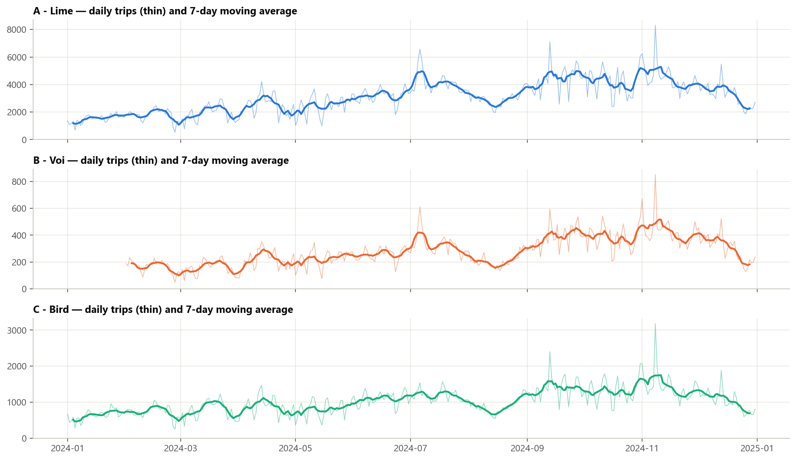

*Figure 3 – Daily trips and 7-day moving average.*

All operators follow the same seasonal cycle: demand grows from January to July, drops in August (summer holidays) and reaches its maximum in September–November. For Lime, mean daily trips rise from 1,507 in January to 4,494 in November; the corresponding figures are 156 → 433 for Voi and 634 → 1,449 for Bird. The growth comes from two sources that the operators combine differently. Lime increases both the active fleet (816 → 1,678 vehicles in July) and utilisation (3.0 → 4.4 trips per vehicle-day in September). Voi's utilisation is almost flat (1.6–1.9 trips per vehicle-day), so its demand follows the fleet. Bird has its largest active fleet in winter (1,430 vehicles in February), when utilisation is lowest. It keeps a smaller and more intensively used fleet in spring–summer, which is a clear sign of fleet rotation rather than demand-driven deployment.

### 2.3 Weekly pattern

Comparing raw weekday totals is misleading for two reasons. 2024 has 53 Mondays and Tuesdays but 52 of every other weekday, and the strong seasonal trend inflates the variance of daily counts. A Kruskal–Wallis test on raw daily counts finds no weekday effect for Lime (p = 0.16). The appropriate design treats each week as a block. Each day is expressed as a seasonal index (daily trips divided by the centred 7-day moving average) and tested with the Friedman test on the 52 complete weeks.

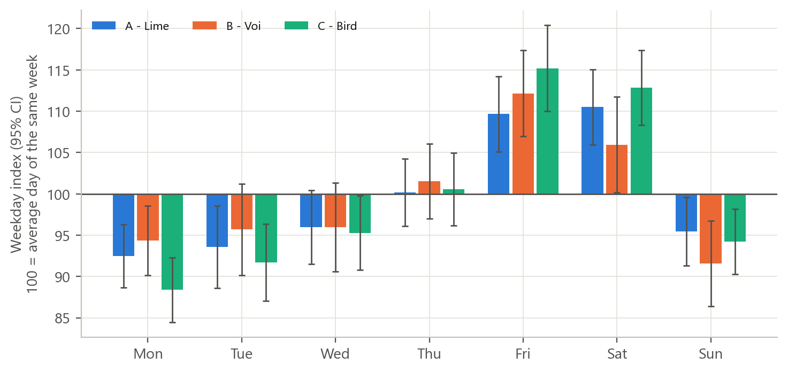

*Figure 4 – Weekday index with 95% confidence intervals (100 = average day of the same week).*

The weekday effect is highly significant for all operators (Friedman χ² = 59.0, 34.6 and 86.4; p < 10⁻⁵; Kendall's W = 0.19, 0.12, 0.28). The profile is the same for the three services. Friday (index 1.10–1.15) and Saturday (1.06–1.13) are the busiest days, and Monday (0.88–0.94) and Tuesday the quietest. The "Sunday peak" previously reported for Voi was an artefact of the date-parsing error (every trip had been assigned to the first day of its month).

### 2.4 Daily pattern

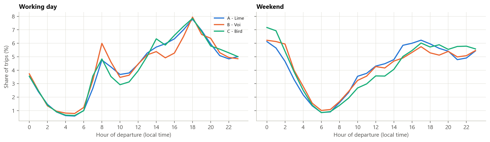

*Figure 5 – Share of trips by hour of departure, working days and weekends.*

On working days the three hourly profiles are almost identical (pairwise correlations ≥ 0.96). A morning peak at 08:00–08:59 (4.8–6.0% of daily trips) is followed by a trough at 10:00–11:59, a steady rise through the afternoon and the daily maximum at 18:00–18:59 (7.8–7.9%). Demand remains high in the evening, around 5% per hour until midnight. At weekends the morning peak disappears and the hours 00:00–01:59 carry 5.6–7.2% of trips each, revealing a leisure and night-life use. These common profiles justify using the same time bands for all operators in the spatial analysis: AM peak 08–09, inter-peak 10–12, PM peak 17–19 and night 23–05 (working days).

### 2.5 Fleet utilisation

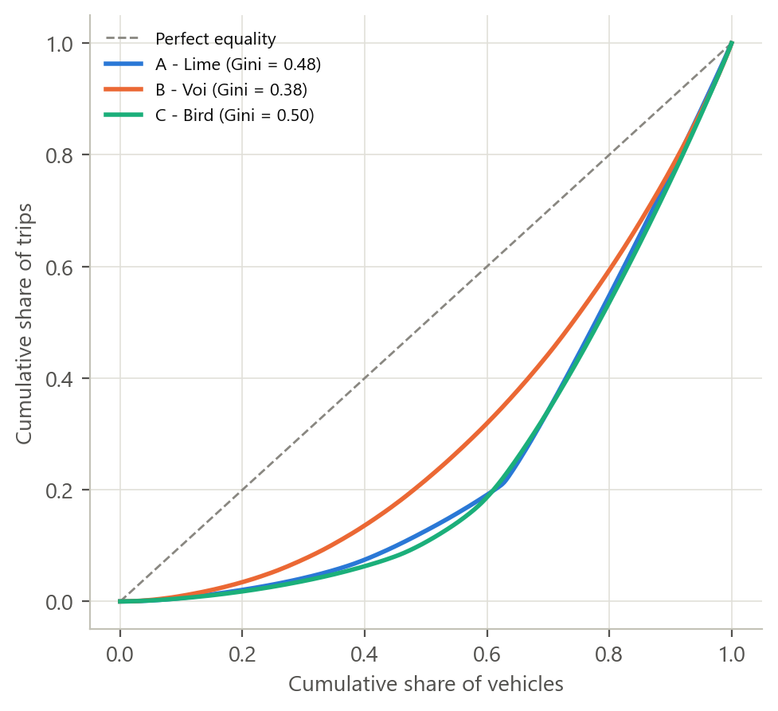

*Figure 6 – Lorenz curves of trips per vehicle (2024).*

The distribution of annual trips across vehicles is unequal for all operators (Gini = 0.48 for Lime, 0.38 for Voi, 0.50 for Bird). The most-used half of the fleet generates 87% of trips for Lime, 89% for Bird and 78% for Voi. This partly reflects fleet rotation, since vehicles that enter or leave service during the year accumulate few trips, and it is consistent with the monthly boxplots below. Within each month, the inter-quartile range of trips per vehicle is wide for all operators. It is widest in the autumn months, when a subset of vehicles is used very intensively.

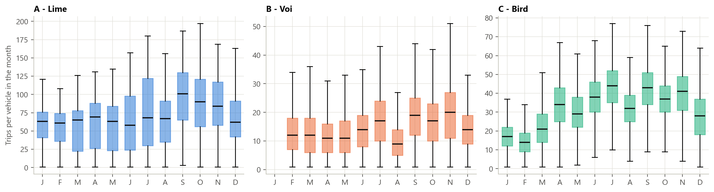

*Figure 7 – Trips per vehicle within each month.*

### 2.6 Battery consumption (Lime and Voi)

Batteries are swapped and carry no identifier, so energy performance is analysed at trip level. Three indicators are used: battery drop (percentage points), consumption per kilometre and consumption per minute. As in the first edition, the Tukey upper fences (Q3 + 1.5 IQR) on the two intensive indicators define four consumption regimes.

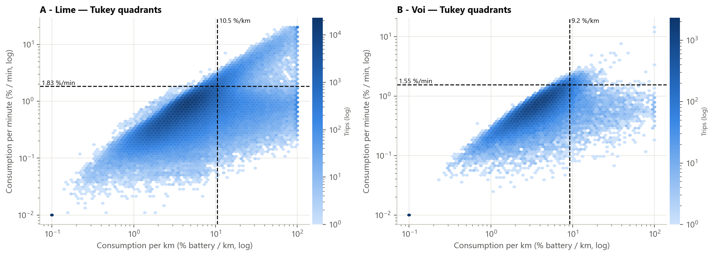

*Figure 8 – Consumption per km vs per minute with Tukey fences (hexagonal binning, log scales).*

**Table 3 – Tukey consumption regimes**

| Operator | Regime | Trips | Share (%) | Battery drop, median [IQR] |
|:---|---:|---:|---:|---:|
| A - Lime | High efficiency | 1,046,292 | 93.1 | 6 [3–9] |
| A - Lime | Long but low-intensity | 49,451 | 4.4 | 11 [6–18] |
| A - Lime | Short but intense | 8,470 | 0.8 | 16 [11–23] |
| A - Lime | Stressful | 19,998 | 1.8 | 21 [14–33] |
| B - Voi | High efficiency | 92,367 | 94.3 | 5 [3–8] |
| B - Voi | Long but low-intensity | 3,743 | 3.8 | 8 [5–12] |
| B - Voi | Short but intense | 862 | 0.9 | 8 [6–11] |
| B - Voi | Stressful | 954 | 1.0 | 7 [5–11] |

93.1% of Lime trips and 94.3% of Voi trips fall in the "high efficiency" regime, with a median drop of 6 and 5 points respectively. The "stressful" regime, above both fences, contains 1.8% of Lime and 1.0% of Voi trips. These are compatible with steep climbs, aggressive riding, battery-gauge recalibration or GPS errors, and are treated as anomalies rather than typical behaviour.

To quantify the marginal cost of distance and time, the battery drop was regressed on straight-line distance and duration (OLS, HC3 robust errors). For Lime, each kilometre costs 2.22 points (95% CI 2.19–2.24) and each minute 0.33 points (0.329–0.337), R² = 0.42. For Voi the figures are 1.77 points/km and 0.24 points/min, R² = 0.54. The pooled coefficients (1.99 points/km, 0.29 points/min, intercept 0.99) are used to estimate the energy consumption of Bird, which reports no battery data. This replaces the "1% every 180 m" rule of thumb of the first edition.

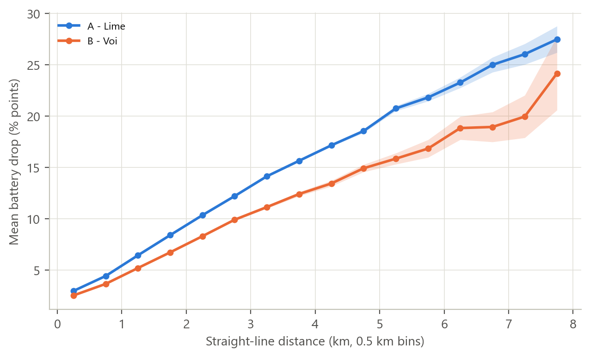

*Figure 9 – Mean battery drop by distance band (95% CI).*

## 3. Origin-destination analysis and spatial dynamics

### 3.1 Method

Trips are assigned to the 94 official statistical zones of Turin through a point-in-polygon join of their origin and destination; 97.8–99.8% of trips have both ends within the city. From the OD matrix the following zonal indicators are computed:

* **Self-containment**: SCᵢ = qᵢᵢ / Oᵢ, the share of trips generated by zone i that end in the same zone;
* **Normalised net flow** in time band t: NFᵢ,ₜ = (Dᵢ,ₜ − Oᵢ,ₜ) / (Dᵢ,ₜ + Oᵢ,ₜ), from −1 (pure generator) to +1 (pure attractor);
* **Tidal index**: TVᵢ = ASᵢ,AM − ASᵢ,PM, where ASᵢ is zone i's share of all trip destinations in the AM peak (08–09) and in the PM peak (17–19), in percentage points.

Two improvements make these indicators statistically interpretable:

1. **Significance.** For each zone, net flow is tested with an exact binomial test (H₀: a trip touching the zone is equally likely to arrive or depart), and the tidal index with a two-proportion z-test (H₀: equal attraction share in AM and PM). With up to 80 zones tested per map, p-values are adjusted with the Benjamini–Hochberg procedure (false-discovery rate 5%). Zones with fewer than 30 events are not tested. **On every map, non-significant zones are hatched in grey**, so only statistically supported colours remain.
2. **Spatial statistics.** Global Moran's I (queen contiguity, 999 permutations) tests whether similar values cluster in space, and local Moran (LISA) maps the significant clusters.

### 3.2 Annual matrices

**Table 4 – Annual OD indicators**

| Indicator | A - Lime | B - Voi | C - Bird |
|:---|---:|---:|---:|
| Trips with both ends in the city | 1,121,764 | 98,024 | 362,526 |
| Intra-zonal trips | 128,606 | 10,516 | 42,284 |
| Self-containment, % [95% CI] | 11.46 [11.41, 11.52] | 10.73 [10.54, 10.92] | 11.66 [11.56, 11.77] |
| Zones generating trips (of 94) | 88 | 77 | 83 |
| Connectivity, % of 8,742 OD pairs | 64.4 | 41.2 | 63.3 |
| Pairs with ≥ 1 trip per week, % | 25.4 | 5.5 | 17.9 |
| Share of 10 busiest pairs, % | 4.5 | 5.4 | 3.0 |

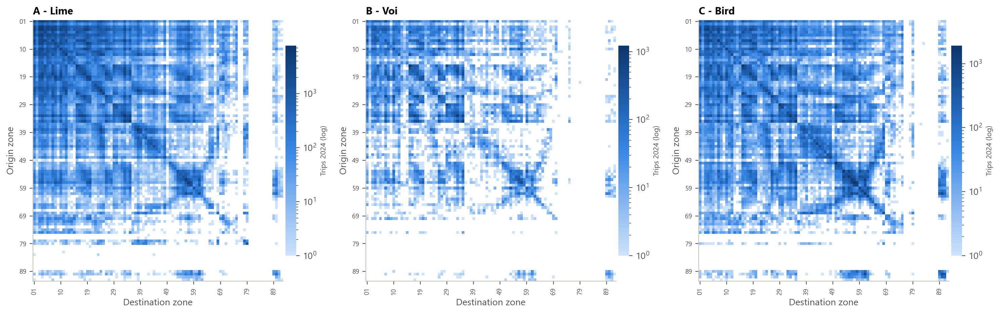

*Figure 10 – Annual OD matrices (log scale).*

**Self-containment is about 11% for every operator** (Lime 11.5%, Voi 10.7%, Bird 11.7%). The first edition reported 0.01–0.08% because intra-zonal trips had been deleted from the matrix before the indicator was computed. One trip in nine therefore stays inside its statistical zone. Micromobility is mainly, but not exclusively, an inter-zonal mode.

Connectivity, the share of the 8,742 possible inter-zonal pairs with at least one trip, is 64% for Lime and 63% for Bird but only 41% for Voi. The difference reflects Voi's smaller volume and service area rather than a different spatial logic. A stricter measure counts pairs with at least one trip per week on average: 25% for Lime, 18% for Bird and 5% for Voi. Demand is not concentrated on a few corridors, since the ten busiest OD pairs carry only 3–5% of inter-zonal trips.

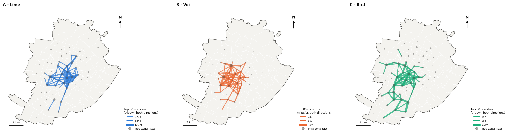

*Figure 11 – Top 80 corridors (both directions) and intra-zonal trips.*

The busiest Lime corridors link the historic centre (zones 01, 03, 04), San Salvario (09–19), Porta Susa (08) and Borgo San Paolo – Polo Nord (33–35). Bird shows a strong southern axis along Molinette – Millefonti – Lingotto (56–57–58–61) and Santa Rita – Ospizio di Carità (53–55). Voi is centred on the west, around Borgo San Paolo, Crocetta and the Politecnico area (17bis, 18, 26, 33, 35). All top corridors are nearly symmetric (a→b ≈ b→a), as expected from return trips over the day.

### 3.3 Trip generation density and spatial clustering

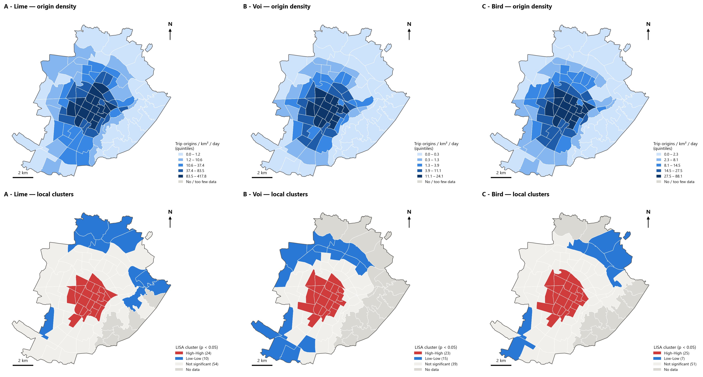

*Figure 12 – Trip origin density (top) and LISA clusters of log density (bottom).*

Trip generation is strongly spatially autocorrelated (Moran's I = 0.63 Lime, 0.68 Voi, 0.56 Bird; p = 0.001). LISA identifies one compact High-High cluster of 23–25 central zones, from Borgo San Donato and Borgo San Paolo in the west to San Salvario in the east, including Porta Susa, Porta Nuova and Crocetta, and Low-Low clusters in the northern periphery and, for Voi, in the south-west. No spatial outliers (High-Low or Low-High) are found. The zonal patterns of the three operators are almost identical (Spearman ρ between log densities = 0.91–0.97). The operators compete for the same central market.

### 3.4 Net flow and tidal pattern

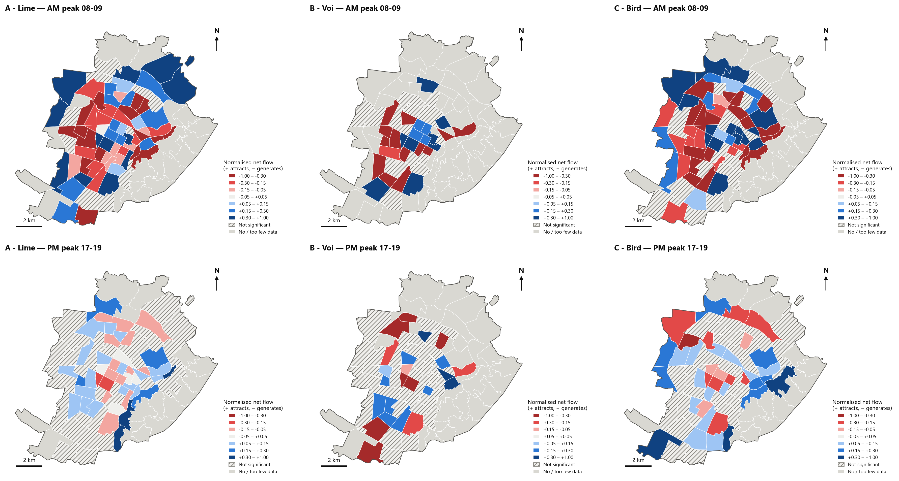

*Figure 13 – Normalised net flow, AM and PM peaks (working days). Hatched: not significant at 5% FDR.*

**Table 5 – Zones with a significant imbalance (5% FDR): significant/tested (+ attractors / − generators)**

| Indicator | A - Lime | B - Voi | C - Bird |
|:---|---:|---:|---:|
| Net flow, AM peak | 65/75  (+28 / −37) | 26/45  (+12 / −14) | 57/76  (+25 / −32) |
| Net flow, inter-peak | 46/77  (+17 / −29) | 16/49  (+6 / −10) | 27/78  (+13 / −14) |
| Net flow, PM peak | 45/79  (+28 / −17) | 23/64  (+12 / −11) | 37/80  (+23 / −14) |
| Net flow, night | 70/79  (+51 / −19) | 37/60  (+23 / −14) | 58/79  (+38 / −20) |
| Tidal index | 63/79  (+20 / −43) | 37/57  (+10 / −27) | 58/78  (+21 / −37) |

In the AM peak 65 of the 75 tested zones are significantly unbalanced for Lime, as are 57 of 76 for Bird and 26 of 45 for Voi. The PM peak is less polarised: 45, 37 and 23 significant zones respectively. The net flows of the two peaks are negatively correlated across zones (Spearman ρ = −0.52 Lime, −0.47 Voi, −0.39 Bird; all p < 0.001), so zones that attract scooters in the morning tend to release them in the evening. Morning net flows are also spatially clustered for Lime (Moran's I = 0.23, p = 0.004).

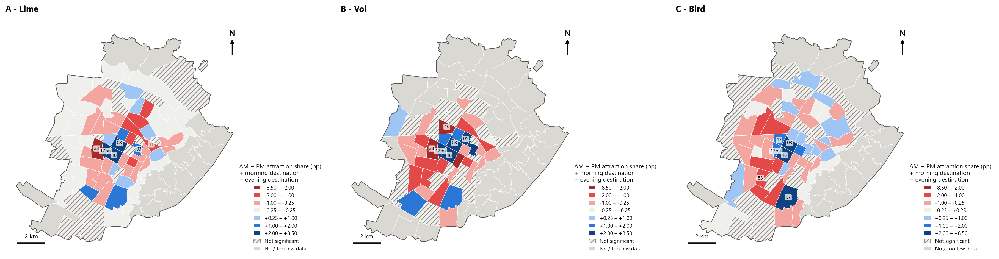

*Figure 14 – Tidal index (AM − PM attraction share). Hatched: not significant at 5% FDR; labels mark the six zones with the largest |TV|.*

The tidal index identifies the city's morning destinations. Positive, significant values are found for Porta Susa station (08), the Politecnico di Torino area (17bis Carceri – Officine Ferroviarie, 18 Vecchia Piazza d'Armi), the historic centre (01, 03) and, for Bird, the hospital district of Molinette (57). Significant negative values, which mark evening destinations, are spread over the residential belt: Borgo San Paolo (33), San Donato (16), Santa Rita (53) and the north-western neighbourhoods. The pattern is statistically significant in 63 of 79 zones for Lime, 37 of 57 for Voi and 58 of 78 for Bird. It is consistent across operators (Spearman ρ between operators' tidal indices = 0.61–0.66, p < 10⁻⁶), which indicates a structural feature of the city's activity pattern rather than an operator effect.

### 3.5 Self-containment by zone

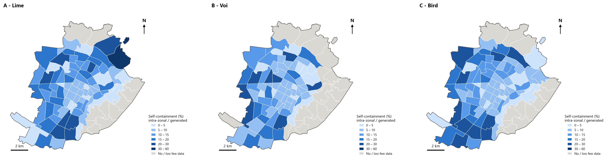

*Figure 15 – Self-containment by zone (zones with fewer than 30 trips generated in grey).*

Self-containment varies from below 5% in small central zones to 20–30% in larger semi-peripheral zones such as Lingotto, Millefonti, Parella or Sanatorio – Gerbido, up to 55% in Barca – Bertolla for Lime. In these zones the area itself is big enough to contain a scooter trip. The indicator is spatially clustered (Moran's I = 0.16–0.28, p < 0.01 for Lime and Bird). This geometric effect of zone size must be considered before reading self-containment as "local autonomy".

## 4. Idle time and operator relocations

### 4.1 Method

For each vehicle, the idle time after a trip is the interval until the start of the next trip of the same vehicle, located at the destination of the previous trip. Three changes improve on the first edition:

* idle times are strongly right-skewed (mean ≈ 1.5–2 × median), so zones and time bands are summarised with **medians**;
* gaps longer than 24 h, which indicate a vehicle withdrawn for charging, repair or storage, are reported as a share instead of being averaged;
* a **relocation** is recorded when the next trip starts more than 300 m from where the previous one ended. Users cannot move a locked scooter, so this is a direct, observed trace of operator interventions (rebalancing, battery swaps, pick-ups).

### 4.2 Results

**Table 6 – Idle time and relocations**

| Indicator | A - Lime | B - Voi | C - Bird |
|:---|---:|---:|---:|
| Idle periods | 1,122,016 | 92,276 | 368,529 |
| Gaps > 24 h, % | 9.4 | 36.7 | 24.5 |
| Median idle time ≤ 24 h, h [95% CI] | 2.27 [2.26, 2.28] | 4.75 [4.66, 4.84] | 3.90 [3.87, 3.93] |
| Mean idle time ≤ 24 h, h | 4.7 | 7.0 | 6.6 |
| Relocation > 300 m, % [95% CI] | 4.2 [4.2, 4.2] | 11.9 [11.7, 12.2] | 11.7 [11.6, 11.8] |
| Kruskal–Wallis across time bands (ε²) | 0.074 | 0.060 | 0.057 |

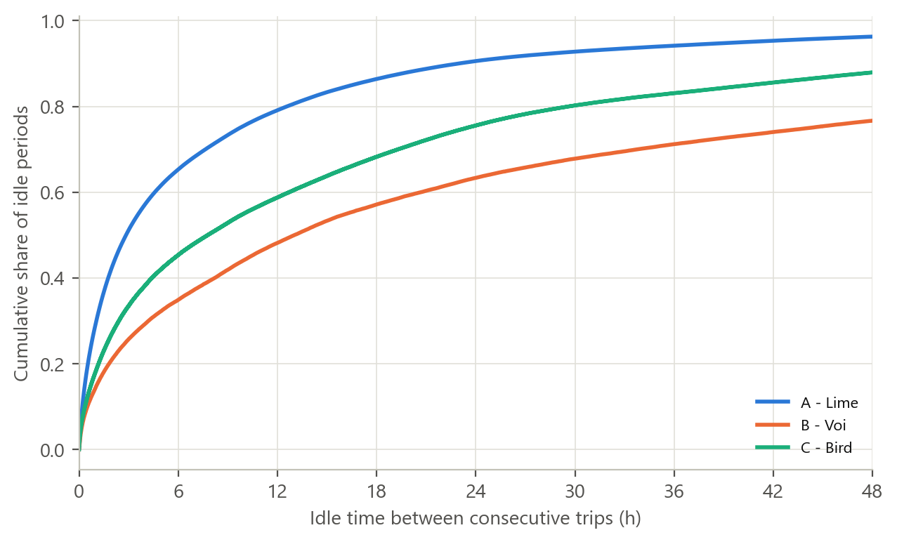

*Figure 16 – Cumulative distribution of idle times.*

Lime vehicles are re-used fastest (median idle time 2.3 h). Voi vehicles wait longest (4.8 h), with Bird in between (3.9 h). Voi and Bird also have far more gaps over 24 h (37% and 24% vs 9%) and three times Lime's relocation rate (11.9% and 11.7% vs 4.2%). This reverses the conclusion of the first edition, which described Voi as the most "liquid" fleet. That result was an artefact of all Voi trips being assigned to the first day of the month.

Idle time differs significantly between time bands (Kruskal–Wallis, all p < 10⁻¹⁰⁰). It is shortest after trips ending in the PM peak (median 1.5 h for Lime, 2.7 h for Bird, 3.1 h for Voi) and longest after night trips (6.8–9.2 h), as vehicles wait for the next morning.

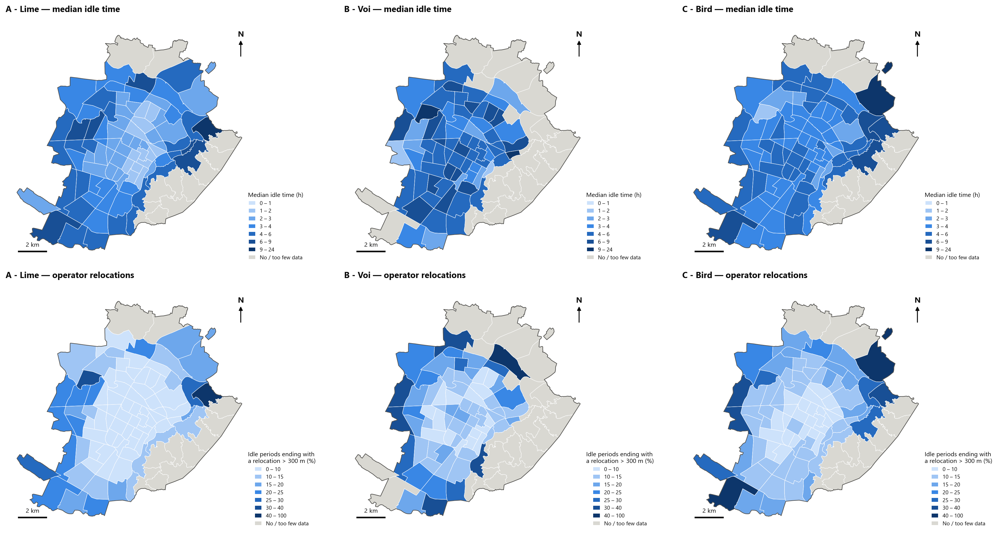

*Figure 17 – Median idle time (top) and share of idle periods ending with an operator relocation (bottom).*

The spatial pattern is unambiguous. For Lime, median idle time falls sharply with demand density (Spearman ρ = −0.79 across zones), and the relocation rate falls even more steeply (ρ = −0.94, −0.74 and −0.87 for Lime, Voi and Bird). Vehicles left in peripheral zones are rarely picked up by a new user and must instead be collected by the operator. This is the operational mechanism behind the rebalancing costs discussed in Section 7.

## 5. Comparison with the public-transport supply

### 5.1 Data and a limitation of the GTFS feed

Public-transport supply is derived from the GTT GTFS feed, restricted to the urban network (agency "U": 129 bus, 8 tram and 1 metro routes). Inspection of the service calendar showed that the feed contains the complete urban timetable only until 28 February 2026, with about 10,550 urban vehicle trips per weekday. From March 2026 onwards it holds only 775 trips per day. The feed therefore **contains no summer timetable**. The July/December comparison of the first edition rested on matching services to months by month number only and summing all service variants, which produced the implausible +931% ratio. It has been withdrawn.

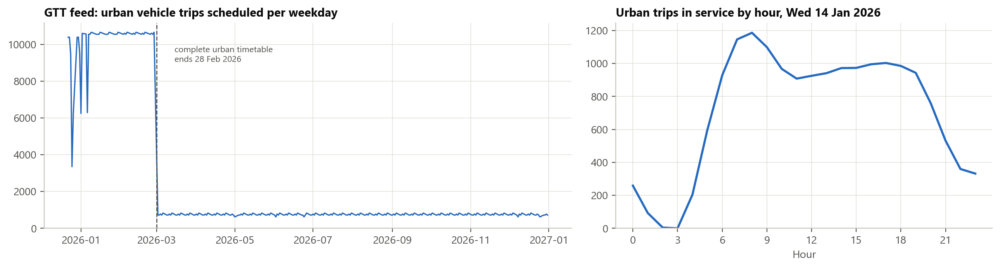

*Figure 18 – Urban vehicle trips scheduled per weekday in the feed (left) and hourly supply on the reference day (right).*

Supply is therefore taken from one representative school-period weekday, Wednesday 14 January 2026, with services resolved through both `calendar.txt` and `calendar_dates.txt`. On that day 10,548 urban vehicle trips serve 3,666 stops. The network peaks at 08:00 (1,186 trips in service) and drops to 332 at 23:00. The 2025-26 timetable is used as a proxy for 2024, and supply is held fixed, so only the micromobility side is compared between July and December 2024 (working days, all operators pooled).

### 5.2 Trip-level relationship with transit

**Table 7 – Trip-level relationship with the urban transit network (%, 95% CI)**

| Indicator | July | December |
|:---|---:|---:|
| Origin within 250 m of an active stop | 99.1 [99.0, 99.1] | 99.1 [99.1, 99.2] |
| Direct urban line between O and D stops (<=250 m) | 60.3 [60.0, 60.6] | 59.1 [58.8, 59.4] |
| Origin or destination <=300 m from a metro station | 33.7 [33.4, 33.9] | 32.1 [31.8, 32.4] |
| Median distance to nearest active stop (m) | 76 | 77 |
| Trips analysed (working days, all operators) | 128,135 | 102,300 |

Almost every trip (99%) starts within 250 m of an active stop (median distance 76 m), so in Turin proximity to transit does not discriminate between trips. A more informative indicator is whether a single urban line connects stops within 250 m of the origin and of the destination. This holds for 60.3% of July trips and 59.1% of December trips. These trips could in principle be made by transit without a transfer, a first indication of potential substitution, although travel time and waiting are not considered. One trip in three (33.7% in July, 32.1% in December) starts or ends within 300 m of a metro station, a strong indication of a feeder role for line 1. The seasonal differences are statistically significant but small (−1.2 and −1.6 percentage points).

### 5.3 Bivariate hexagon maps

The city is covered by a 250 m hexagonal grid. For each hexagon two layers are computed. *PT passages* is the number of distinct vehicle trips calling at any stop in the hexagon during the hour, so a line with two stops in the same hexagon is not double-counted. *Micromobility* is the number of trip origins in that hour over all working days of the month. PT classes use headway thresholds (fewer than 4 passages/h, i.e. headway above 15 min or no service; 4–11; 12 or more, i.e. headway of 5 min or less). Micromobility classes are tertiles of the non-zero counts (≤ 4, 5–14, ≥ 15 trips), pooled over the four scenarios so that colours mean the same thing on every map.

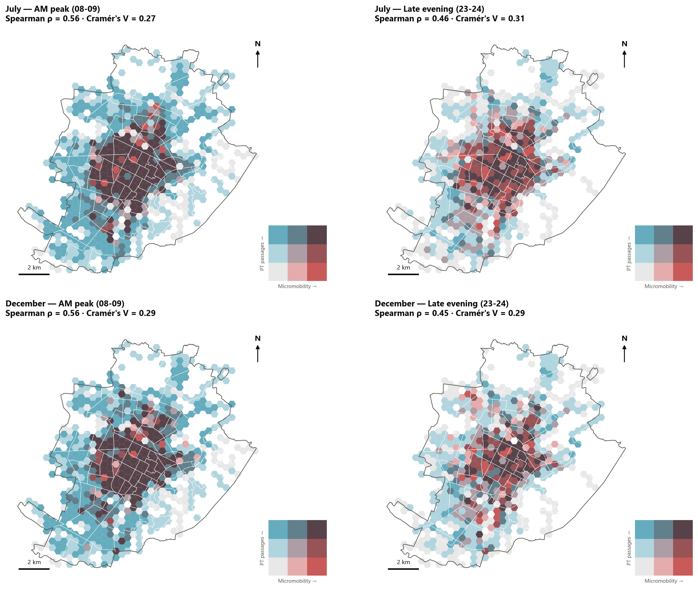

*Figure 19 – Bivariate classes of PT supply and micromobility demand. Titles report the Spearman correlation and Cramér's V between the two layers.*

**Table 8 – Association between PT supply and micromobility in 250 m hexagons**

| Scenario | Active hexagons | Spearman ρ | Cramér's V | Class 33 (both high) | Class 13 (micro high, PT low) | Class 31 (PT high, micro low) |
|:---|---:|---:|---:|---:|---:|---:|
| July — AM peak (08-09) | 614 | 0.56 | 0.27 | 111 | 7 | 176 |
| July — Late evening (23-24) | 561 | 0.46 | 0.31 | 52 | 17 | 21 |
| December — AM peak (08-09) | 614 | 0.56 | 0.29 | 114 | 4 | 170 |
| December — Late evening (23-24) | 557 | 0.45 | 0.29 | 45 | 13 | 27 |

The two layers are positively and moderately associated in every scenario (Spearman ρ = 0.56 in the AM peak and 0.45–0.46 in the late evening; Cramér's V = 0.27–0.31; χ² tests p < 10⁻¹⁵). Micromobility is densest where transit is densest: in the AM peak about 110 hexagons are in class 33 (both high). Hexagons with high micromobility and low transit supply (class 13) are rare in the AM peak (4–7) and become more frequent in the late evening (13–17), when transit frequency drops by a factor of 3.6. Micromobility thus overlaps the transit network spatially and partly compensates for the thinner night service. Hexagons with frequent transit but little micromobility (class 31) are numerous in the AM peak (170–176), mainly along radial corridors in the outer districts.

## 6. Zonal demand model and socio-economic hardship

### 6.1 Model

The first edition compared the bivariate maps with ISTAT's index of socio-economic hardship (IDISE 2021) only visually. Here the question is tested explicitly: *conditional on density, centrality and transit supply, do more deprived zones generate fewer e-scooter trips?* The ISTAT sub-municipal areas coincide with the statistical zones, so IDISE and resident population are available for 89 zones with at least 500 residents.

Annual trip origins (all operators) are modelled with a negative binomial regression with log(area) as exposure offset, so that coefficients refer to trip density. The covariates are log population density, standardised IDISE, distance from Piazza Castello, log PT passages per km² on the reference day, and a dummy for zones with a metro station. Poisson regression is rejected because the counts are heavily over-dispersed (Pearson dispersion ≈ 4,500; NB α = 0.92). Variance inflation factors are below 3.1.

### 6.2 Results

**Table 9 – Negative binomial model of annual trip origins per zone (offset: log area; n = 89 zones)**

| Variable | IRR [95% CI] | p-value | VIF |
|:---|---:|---:|---:|
| log population density | 1.68 [1.31, 2.14] | < 0.001 | 2.8 |
| IDISE hardship index (1 SD) | 1.06 [0.85, 1.33] | 0.584 | 1.1 |
| Distance to centre (km) | 0.65 [0.57, 0.75] | < 0.001 | 1.3 |
| log(1 + PT passages per km²·day) | 3.71 [2.54, 5.41] | < 0.001 | 3.1 |
| Metro station in zone | 0.92 [0.49, 1.71] | 0.793 | 1.2 |

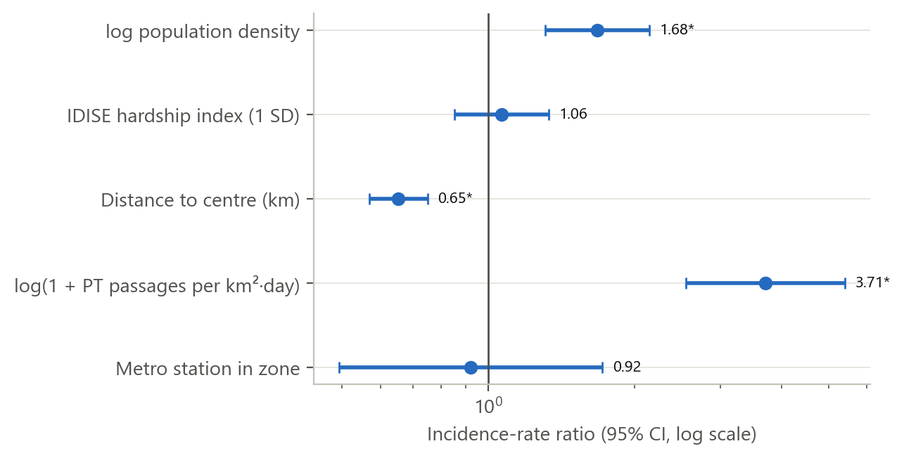

*Figure 20 – Incidence-rate ratios with 95% confidence intervals (* p < 0.05).*

Three factors explain where trips start (Spearman correlation between observed and fitted density = 0.94):

* **population density**: +10% residents per km² → +5.0% trips (elasticity 0.52);
* **distance from the centre**: each kilometre reduces trip density by 35% (IRR = 0.65);
* **transit supply**: one log-unit more PT passages per km² multiplies trip density by 3.7. Micromobility thrives where public transport is dense, which agrees with the trip-level and hexagon results.

A metro station adds nothing once overall PT density is controlled for (IRR = 0.92, p = 0.79). **Socio-economic hardship has no detectable effect** (IRR = 1.06 per standard deviation of IDISE, 95% CI 0.85–1.33, p = 0.58), and the unconditional correlation between IDISE and trips per resident is also null (ρ = −0.04, p = 0.69). The result is robust to an SLX specification adding the spatial lags of population density, IDISE and PT density (IDISE IRR = 1.02, p = 0.90).

Residual spatial autocorrelation remains (Moran's I = 0.19, p = 0.003), so standard errors are probably somewhat too small. This does not affect the IDISE conclusion, whose estimate is close to 1 with p ≥ 0.58.

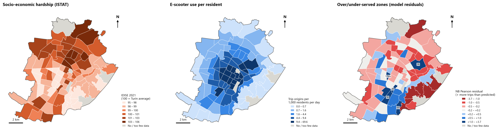

*Figure 21 – IDISE (left), trips per resident (centre) and model residuals (right).*

The data therefore do not support the "double isolation" of deprived districts suggested in the first edition. Low use in Vallette, Falchera or Mirafiori Sud is what their distance from the centre and lower transit density predict, not an additional penalty linked to deprivation. The residual map highlights zones with more trips than predicted: the Politecnico area (17bis Carceri – Officine Ferroviarie), Borgo San Giorgio (28), Mercato Ortofrutticolo (56), Cimitero Generale – Scalo Vanchiglia (36), Fioccardo – Alberoni along the Po (69) and Stadio Comunale (54). These are areas with university, leisure or sport attractors that residential variables do not capture. Zones with fewer trips than predicted are the eastern hills (82–87: Reaglie, Santa Margherita, San Vito, Cavoretto, Pecetto), where gradients discourage scooter use, and Falchera (77).

## 7. Economic feasibility

### 7.1 Model and corrections

Revenue is computed as unlock fees (1 € per trip) plus per-minute charges (0.26 €/min for Lime and Bird, 0.24 €/min for Voi), applied to *started* minutes. Costs follow the assumptions of the first edition: vehicle price 650 € amortised over 2.5 years, insurance 10 € and platform 40 € per vehicle per year, a 1,200 m² warehouse at 6 €/m²/month, four local staff at 45,000 €, energy at 0.25 €/kWh with 0.46 kWh batteries and 12% charging losses, rebalancing 2 € per vehicle-day, maintenance 200 € per vehicle-year and connectivity 1.2 € per vehicle-month.

Four changes were made:

1. Inputs come from the corrected datasets. Voi revenue falls from 0.84 M€ to 0.34 M€ because the first edition counted 2025 trips and duplicated rows.
2. **Fleet basis.** The first edition charged rebalancing and amortisation on every vehicle identifier seen during the year, as if all 2,189 Lime vehicles had been on the street for 365 days. Because operators rotate vehicles, the average deployed fleet (mean monthly active vehicles: 1,336 Lime, 554 Voi, 1,016 Bird) is a more realistic basis. Both bases are reported as a lower and an upper cost scenario.
3. Bird's energy use is estimated from the battery regression of Section 2.6.
4. Parameter uncertainty is propagated with a Monte Carlo simulation: 20,000 draws from triangular distributions for effective per-minute revenue (70–100% of list price, accounting for passes and discounts), rebalancing (1–3 €/vehicle-day), maintenance (100–350 €/year), vehicle price (450–850 €), vehicle life (1.5–3.5 years) and staff cost (35–55 k€).

### 7.2 Results

**Table 10 – Profit and loss, thousand € per year (two fleet bases)**

| Item | Lime (all IDs) | Lime (deployed) | Voi (all IDs) | Voi (deployed) | Bird (all IDs) | Bird (deployed) |
|:---|---:|---:|---:|---:|---:|---:|
| Revenue | 4,157 | 4,157 | 338 | 338 | 1,652 | 1,652 |
| Fleet amortisation | 569 | 347 | 307 | 144 | 541 | 264 |
| Insurance | 22 | 22 | 12 | 12 | 21 | 21 |
| App / platform | 88 | 88 | 47 | 47 | 83 | 83 |
| Warehouse | 86 | 86 | 86 | 86 | 86 | 86 |
| Staff | 180 | 180 | 180 | 180 | 180 | 180 |
| Energy | 11 | 11 | 1 | 1 | 4 | 4 |
| Rebalancing & logistics | 1,598 | 975 | 861 | 404 | 1,520 | 742 |
| Maintenance | 438 | 267 | 236 | 111 | 416 | 203 |
| Connectivity | 32 | 19 | 17 | 8 | 30 | 15 |
| Total cost | 3,023 | 1,996 | 1,747 | 993 | 2,882 | 1,598 |
| Profit | 1,133 | 2,161 | -1,410 | -655 | -1,230 | 54 |
| Fleet used for costing | 2,189 | 1,336 | 1,180 | 554 | 2,082 | 1,016 |
| Monte Carlo P(profit > 0) |  | 100% |  | 0% |  | 20% |

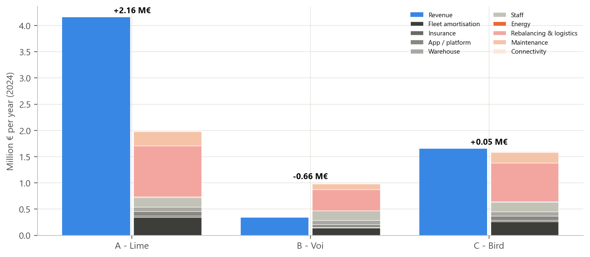

*Figure 22 – Revenue and cost composition (deployed-fleet basis).*

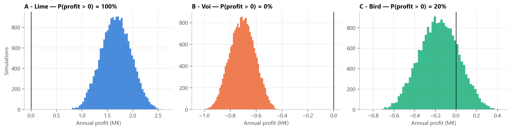

*Figure 23 – Monte Carlo distribution of annual profit (deployed-fleet basis, uncertain tariffs and costs).*

* **Lime** is profitable under both fleet bases (1.13 M€ with all vehicle IDs, 2.16 M€ with the deployed fleet) and in 100% of Monte Carlo draws (90% interval 1.18–2.16 M€).
* **Voi** is loss-making in every scenario: −1.41 M€ (all IDs) or −0.66 M€ (deployed fleet), and in 100% of simulations (90% interval −0.86 to −0.55 M€). Its revenue of 0.34 M€ does not cover even the fixed staff and warehouse costs plus amortisation.
* **Bird** sits close to the threshold. It loses 1.23 M€ if every vehicle ID is costed for the whole year, but roughly breaks even (+0.05 M€) on the deployed fleet. With uncertain tariffs and costs the probability of a profit is 20% (90% interval −0.48 to +0.15 M€).

Rebalancing and logistics are the largest cost item for every operator (41–49% of total costs on the deployed basis). Energy is negligible (< 1%).

### 7.3 Break-even utilisation

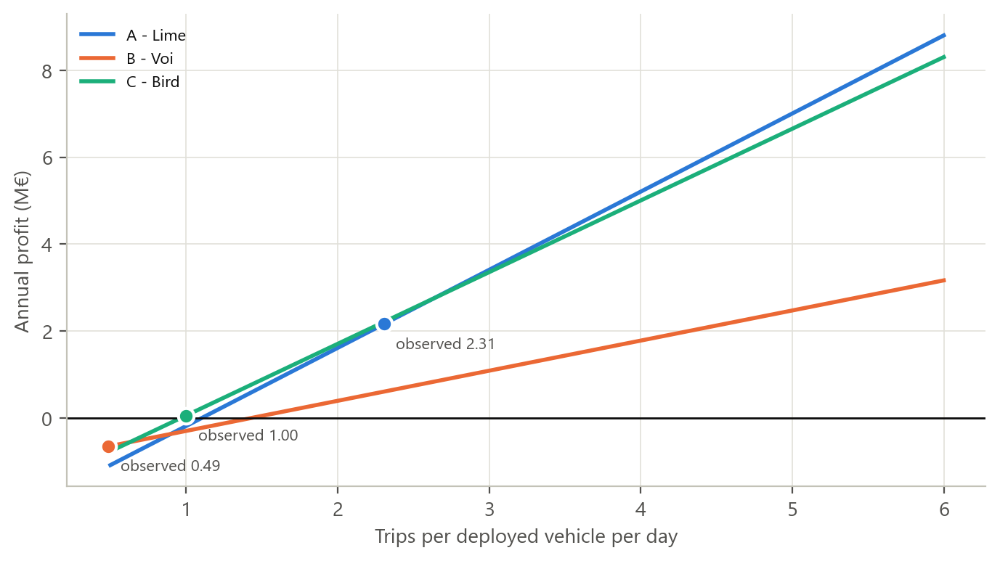

*Figure 24 – Annual profit as a function of trips per deployed vehicle per day; dots mark the observed values.*

Holding the fleet and the cost parameters fixed, the break-even utilisation is about one trip per deployed vehicle per day: 1.10 for Lime, 1.43 for Voi and 0.97 for Bird. Lime operates at 2.31, more than double its threshold. Bird operates at 1.00, almost exactly at break-even. Voi operates at 0.49, about one third of what it would need. Profitability is therefore governed less by fleet size than by **utilisation per deployed vehicle**, which the spatial analysis links to where vehicles are placed. Relocations are three times as frequent for Voi and Bird as for Lime, and their idle times are 70–110% longer.

## Conclusions

**Demand is common, operators differ.** The three operators serve the same trips: 8–10 minutes and 1.3–1.5 km, with an AM peak at 08:00, a PM peak at 18:00, a Friday–Saturday peak, an autumn maximum and an August dip. They serve the same places, with near-identical zonal densities (ρ > 0.9) and a single central High-High cluster. What differs is how intensively the vehicles are used: 3.5 trips per active vehicle-day for Lime, 2.1 for Bird and 1.7 for Voi.

**Micromobility follows the city's daily tide.** Morning destinations (Porta Susa, the Politecnico, the historic centre, the Molinette hospital district) and evening destinations (the residential belt) are statistically significant in most zones and consistent across operators. About 11% of trips stay within a statistical zone, so the service is mainly inter-zonal but by no means only so.

**Micromobility clusters where transit is dense.** Trip density rises with PT supply (IRR 3.7) and one trip in three touches a metro station, but 60% of trips could also be made on a single direct urban line. E-scooters both feed and compete with transit. They partially fill the gap left by the thinner late-evening service.

**No evidence of a deprivation penalty.** Once density, centrality and transit supply are controlled for, the ISTAT hardship index has no effect on use. Peripheral, deprived zones see little use because they are peripheral and less well served, not because they are deprived.

**Utilisation decides profitability.** Lime is robustly profitable. Bird is at break-even and its result depends on how many vehicles it actually deploys. Voi would need roughly three times its current utilisation. Vehicles left in low-demand areas wait longer and must be relocated more often, so rebalancing, the dominant cost item, is the link between the spatial and the economic results. For the Municipality, this suggests licensing conditions that reward utilisation and coverage of transit nodes rather than fleet size.

## Limitations

* Distances are straight-line distances; no route data are available for Voi and Bird.
* The GTFS feed (2025-26) is a proxy for the 2024 timetable and contains no summer timetable, so seasonal changes in transit supply could not be analysed.
* The cost model relies on market and literature assumptions, not operator accounts; the Monte Carlo ranges quantify, but do not remove, this uncertainty.
* The zonal model has residual spatial autocorrelation, and zones are large relative to scooter trips (modifiable areal unit problem).
* The Dott fleet, active in the same period, is not included.

## Appendix A — Corrections with respect to the first edition

**Table 11 – Main corrections**

| Topic | Problem | First edition | Revised |
|:---|---:|---:|---:|
| Self-containment | Intra-zonal trips removed before computing the indicator | 0.01–0.08 % | ≈ 11 % for all operators |
| Voi dataset | Merged file contained Jan–Oct 2025 and 59,226 duplicated rows | 256,412 trips; 1,440 vehicles; 39.4 % reserved | 98,295 trips; 1,180 vehicles; 23.0 % reserved |
| Voi timestamps | Day overwritten with '01' when parsing | 'Sunday busiest'; 'most liquid fleet' | Fri/Sat busiest; longest idle times |
| Voi time zone | Timestamps in UTC | Peaks at 06–07 and 16–17 | Peaks at 08 and 18, as for other operators |
| GTFS seasonal supply | Services matched by month number; all variants summed; feed has no summer timetable | +931 % December vs July | Seasonal PT comparison withdrawn; one reference weekday |
| Weekday analysis | Totals not normalised (53 Mondays/Tuesdays in 2024); seasonal confounding | Raw totals | Seasonal index + Friedman test |
| Cleaning table | Filters counted against raw data (overlaps) | Rows did not add up | Sequential log |
| Idle time | Means of a skewed variable; Voi dates wrong | Mean durations | Medians, >24 h share, relocation rate |
| Socio-economic equity | Visual overlay only | 'Double isolation' of deprived areas | No IDISE effect (IRR 1.06, p = 0.58) |
| Finance | Fleet = every vehicle ID × 365 days; Voi inputs from merged file | Voi −1.23 M€; Bird −1.27 M€ | Two fleet bases + Monte Carlo |

## References

**Methodological references (added in this edition)**

Anselin, L. (1995). Local indicators of spatial association — LISA. *Geographical Analysis*, 27(2), 93–115.

Benjamini, Y., & Hochberg, Y. (1995). Controlling the false discovery rate: a practical and powerful approach to multiple testing. *Journal of the Royal Statistical Society: Series B*, 57(1), 289–300.

Cliff, N. (1993). Dominance statistics: ordinal analyses to answer ordinal questions. *Psychological Bulletin*, 114(3), 494–509.

Conover, W. J. (1999). *Practical Nonparametric Statistics* (3rd ed.). Wiley.

Friedman, M. (1937). The use of ranks to avoid the assumption of normality implicit in the analysis of variance. *Journal of the American Statistical Association*, 32(200), 675–701.

Halleck Vega, S., & Elhorst, J. P. (2015). The SLX model. *Journal of Regional Science*, 55(3), 339–363.

Hilbe, J. M. (2011). *Negative Binomial Regression* (2nd ed.). Cambridge University Press.

Wilson, E. B. (1927). Probable inference, the law of succession, and statistical inference. *Journal of the American Statistical Association*, 22(158), 209–212.

**Data sources**

Città di Torino — anonymised trip data of the licensed e-scooter sharing operators (2024), provided for teaching purposes.

Città di Torino, Geoportale — Zone statistiche (statistical zones).

GTT — Feed GTFS trasporti GTT. http://aperto.comune.torino.it/dataset/feed-gtfs-trasporti-gtt

ISTAT — Indice di disagio socio-economico a livello sub-comunale (IDISE), anno 2021. https://www.istat.it/comunicato-stampa/dati-disagio-socio-economico-livello-sub-comunale-idise-anno-2021/

Città di Torino (2022). Avviso pubblico per il servizio di sharing di monopattini elettrici. https://risorse.comune.torino.it/bandi/pdf/files/59452022-avviso_pubblico_aggiornato_cmto.pdf

**Thematic references (from the first edition)**

Christoforou, Z., Cohen-Blankshtain, G., & Salah, A. A. (2021). Shared e-scooters: A review of use patterns, perceptions and environmental impacts. *Transport Reviews*.

McKinsey & Company (2025). Micromobility's emerging road to profitability.

Montes, A., Geržinic, N., Veeneman, W., van Oort, N., & Hoogendoorn, S. (2023). Shared micromobility and public transport integration – A mode choice study using stated preference data. *Research in Transportation Economics*, 99. https://doi.org/10.1016/j.retrec.2023.101302

Oeschger, G., Carroll, P., & Caulfield, B. (2020). Micromobility and public transport integration: The current state of knowledge. *Transportation Research Part D*, 89, 102628. https://doi.org/10.1016/j.trd.2020.102628

Shah, N. R., Guo, J., Han, L. D., & Cherry, C. R. (2023). Why do people take e-scooter trips? Insights on temporal and spatial usage patterns of detailed trip data. *Transportation Research Part A*, 173, 103705. https://doi.org/10.1016/j.tra.2023.103705

ITDP (2021). Maximizing potential by connecting micromobility and transit. Institute for Transportation and Development Policy.

NACTO (2022). Shared micromobility in the U.S. and Canada. National Association of City Transportation Officials.
